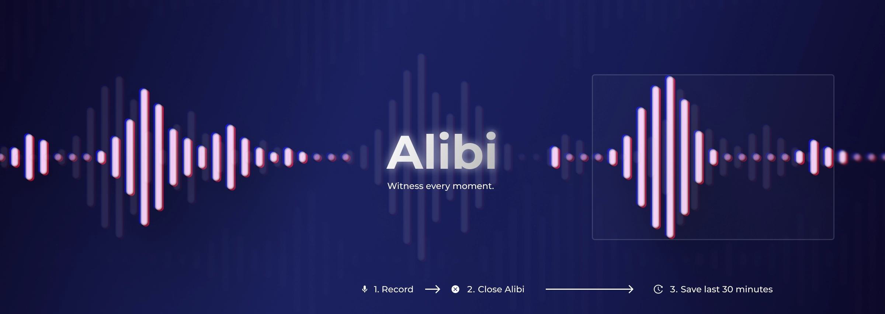
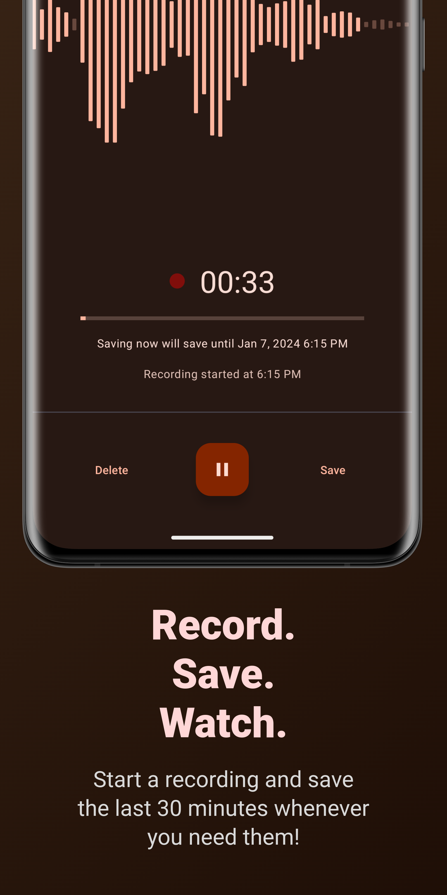
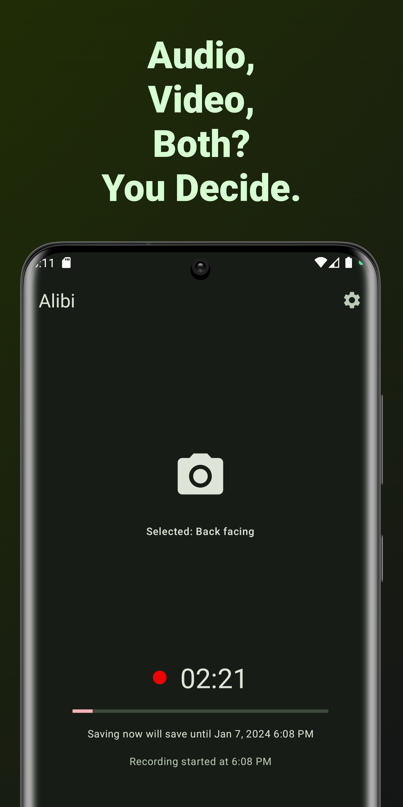
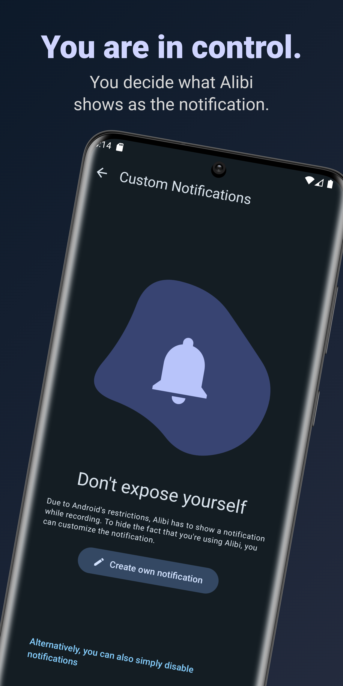
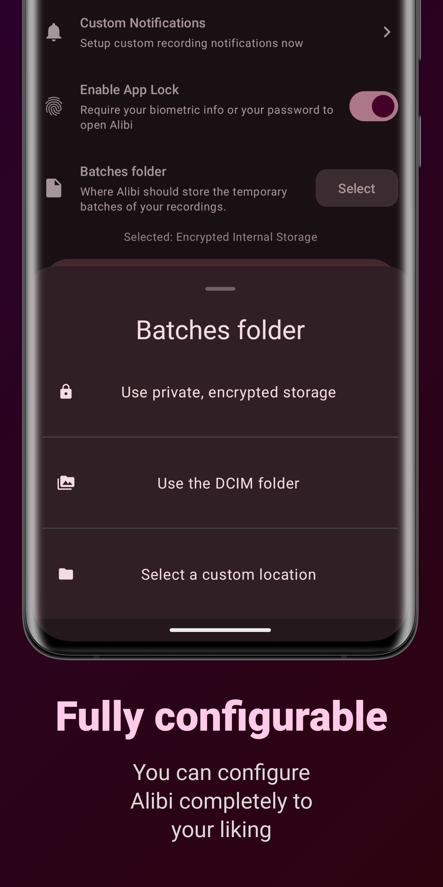
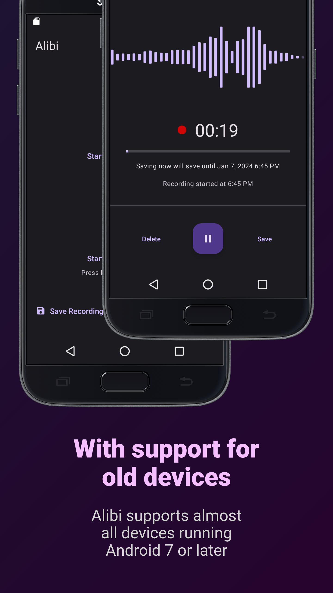
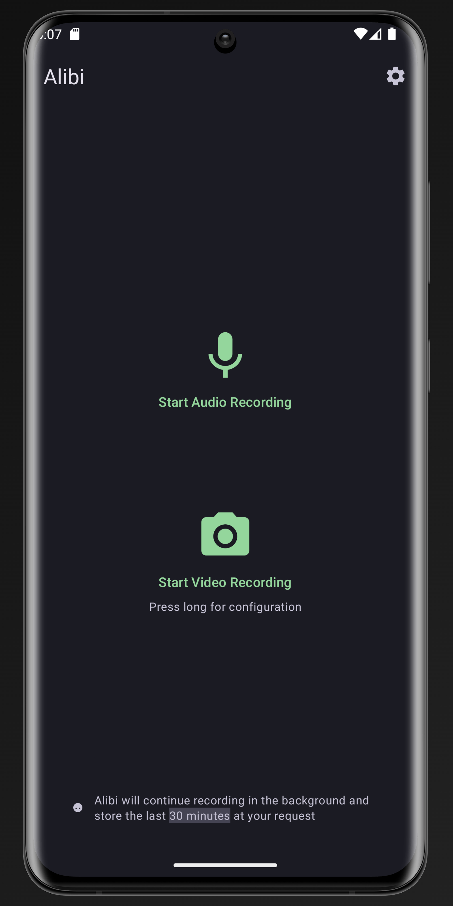

# Alibi

<p float="left" align="center">
    
    
    
    
    
    
</p>

Alibi keeps recording audio/video in the background and saves the last 30 minutes at your request.
Everything is completely configurable. No internet connection required.

## 本 fork 新增功能

- 在设置中开启“音量键快捷录像（上前摄 / 下后摄）”，授予相机、通知权限，并在系统辅助功能中启用 **Alibi 录像快捷键**。长按音量上 0.8 秒开始前摄录像，再长按音量上停止；长按音量下使用选定后摄开始/停止。短按仍调节音量。开始为一次震动、停止为两次震动、失败为三次震动。录制期间使用另一个快捷键会提示忙碌，不切换镜头。
- 设置中的“后置摄像头”支持自动选择、系统开放的后摄逻辑摄像头和物理镜头，显示近似等效焦距及摄像头 ID。选择保存后用于下一次后摄录像，也用于应用内默认后摄；前摄快捷键独立使用前摄。仅列出 CameraX 可用摄像头；厂商未向第三方开放的镜头不会出现。物理镜头路由依据 [Camera2Interop](https://developer.android.com/reference/androidx/camera/camera2/interop/Camera2Interop.Extender)，需要 Android 9 及以上，具体录像分辨率仍受设备限制。
- 辅助功能服务直接启动/停止前台录像服务，不切换到应用界面。已在小米 14 Ultra / Android 16 验证音量下桌面长按开始、停止、震动和顶部红点；新增前摄快捷键及多后摄待真机验收；其他厂商机型及锁屏场景仍需分别验收。
- 小米 / HyperOS 若限制后台启动，可在 Alibi 的系统权限页检查“后台弹出界面”，应用设置提供入口。系统未在 6 秒内允许启动时，请求会取消并提示失败，之后打开应用不会补执行录像。
- 在设置中开启顶部悬浮红点并授予悬浮窗权限；录音/录像时显示红点，暂停或停止后移除。系统状态栏另显示单色圆点图标。
- 主页面右上角的文件夹入口管理录音/录像、片段/已合并文件，支持播放、分享和确认删除。覆盖应用内部目录、应用媒体目录及仍有访问权限的自定义目录。
- 新录制会归档上一轮片段；合并文件予以保留。录制或合并期间禁止删除文件，录制中的片段暂停播放和分享。

构建环境更新为 Gradle 8.13、AGP 8.13.2、Kotlin 2.3.21、Java 17 字节码及 compile/target SDK 36（最低 Android 7.0 保持不变）。依赖集中在 `gradle/libs.versions.toml`。Compose 改用 Kotlin Compose Compiler 插件与统一 BOM；CameraX 更新至 1.6.2；媒体合并使用 Maven Central 发布的 `com.antonkarpenko:ffmpeg-kit-full-gpl:2.2.3` 社区维护版本，替换退役的 FFmpegKit 5.1。

```bash
# 使用 JDK 17 或 21，配置 Android SDK 36
./gradlew assembleDebug testDebugUnitTest
```

# Download

[](https://play.google.com/store/apps/details?id=app.myzel394.alibi)
[](https://f-droid.org/packages/app.myzel394.alibi)
[](https://github.com/Myzel394/Alibi/releases)

# Supporting Alibi

You can support Alibi in various ways:

## Contribute to the project

Add a new feature or fix bugs.

## Add translations

[Translate Alibi into your language using Crowdin](https://crowdin.com/project/alibi), so that other
people can use it more easily.

## Donate

It might sound crazy, but if you would just donate $ 1, it would totally mean the world to me, since
it's a really small amount and if everyone did that, I could focus on Alibi and my other open
source projects. :)

You can donate via [GitHub Sponsors](https://github.com/sponsors/Myzel394) or via [crypto currencies](https://github.com/Myzel394/contact-me?tab=readme-ov-file#donations).
